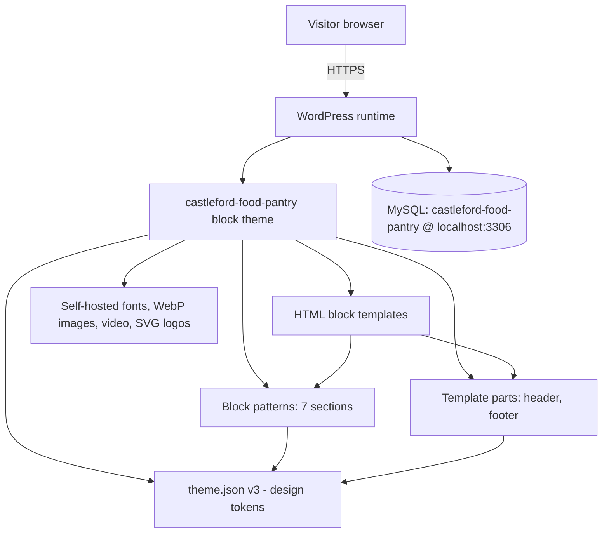
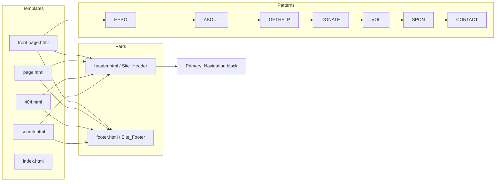
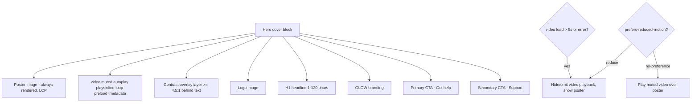

# Design Document

## Overview

The Castleford Community Food Pantry website is a WordPress **block theme** built for Full Site Editing (FSE). It launches as a single-page site composed of anchor-linked sections but is architected so each section can later become a standalone page without rebuilding the theme.

The pantry runs a **surplus-food / anti-waste redistribution model**: it collects surplus food that would otherwise go to waste and makes it available to the community — it is not a traditional donated-stock food bank. The site carries the tagline **"Together we can reduce waste, feed people, build community,"** the mission statement **"We collect surplus food that would otherwise go to waste and make it available to our community,"** and the badge message **"Saving surplus food from landfill."** It operates from centers provided by GLOW (a local church) in church halls, and GLOW's multicolor "GLOW" wordmark is featured prominently throughout, even though GLOW does not run the pantry.

The design is driven almost entirely from `theme.json` (schema v3) as a design-token source of truth, HTML block templates, reusable template parts, and registered block patterns — one pattern per content section. Fonts are self-hosted, media is optimized to next-gen formats, and the hero uses a muted autoplay background video with a reduced-motion and failure fallback to a poster image.

The tone and structure follow established UK community-charity sites — a warm welcome, clearly described services, impact framing, ways to support / get involved, and a sponsor showcase — in the spirit of Armley Helping Hands and Holbeck Together. Content was adapted for this project; no third-party copy is reproduced.

### Design Goals and Mapping to Requirements

| Goal | Requirements |
| --- | --- |
| Editable visually via FSE, no code to change content | 1, 2 |
| Centralized, consistent branding via tokens | 2, 10 |
| Prominent, eye-catching GLOW wordmark | 2.6, 4.3, 10 |
| Engaging, accessible hero with video | 4, 12 |
| Clear service, support/get-involved, volunteer, sponsor, contact content | 5–11 |
| WCAG 2.1 AA conformance | 12 |
| Responsive from 360px up, single-column at ≤782px | 13 |
| Core Web Vitals (LCP < 2.5s, CLS ≤ 0.1) | 14 |
| Discoverable (SEO, structured data, sitemap) | 15 |
| Extensible to multi-page later | 16 |
| Reproducible local env + version control | 17 |

### Key Design Decisions

- **theme.json as the single source of truth.** Colors, fluid type, spacing, and layout widths are declared once as tokens. Blocks reference tokens by slug (`var(--wp--preset--color--brand-green)`), so a token change propagates everywhere (Req 2.5).
- **One block pattern per section.** The seven sections are independently registered patterns. The front page composes them in order; later, any pattern can be dropped onto a standalone page (Req 1.5, 1.6, 16.2).
- **Progressive enhancement for the hero video.** The poster image is the LCP element and always renders first; the video is layered on top and only plays when motion is allowed and it loads in time (Req 4.5–4.7, 14.5).
- **No build step required for the theme to run.** The theme ships as plain PHP/HTML/CSS/JSON so it works in any standard WordPress install. A lightweight optional tooling layer handles image conversion and linting but is not required at runtime.

### Chosen Logo (recommendation)

Three candidates exist in `website-images/`:

- `v2-1-castle-sun-glow.svg` — horizontal lockup: sun/castle mark, "Castleford / FOOD PANTRY", and a "RUN BY GLOW" pill.
- `v2-2-badge-glow.svg` — circular GLOW badge: "CASTLEFORD COMMUNITY · FOOD PANTRY" curved around a central GLOW mark.
- `v2-3-battlement-glow.svg` — castle-battlement banner shape with a "RUN BY GLOW" footer bar.

**Recommendation: the circular GLOW badge (`v2-2-badge-glow.svg`) is the authentic brand mark and is the primary identity.** The real flyer uses this circular badge — "CASTLEFORD COMMUNITY · FOOD PANTRY" curved around a central GLOW mark — as its hero brand mark, with the wordmark set as "CASTLEFORD COMMUNITY" (navy) / "FOOD" (orange-red) / "PANTRY" (purple). Because this matches the pantry's actual, published identity, the design treats it as the real brand mark. Rationale:

- It is the **genuine brand mark the pantry already uses**, so featuring it keeps the site consistent with printed flyers and posters that the community recognizes.
- Its square format (400×400) is ideal as the **primary hero identity mark, favicon, and Open Graph / social-share image**.
- It presents the organization name, the "FOOD PANTRY" descriptor, and the multicolor GLOW mark together, supporting Req 3.1, 10.2, and 10.3.

**Practical header note:** a square badge forces either a small or an oversized header on wide viewports, so the horizontal lockup (`v2-1-castle-sun-glow.svg`, 580×200) is used as the **header lockup where a wide format is needed** — it scales down for mobile without the text becoming unreadable while still presenting the mark, name, and "RUN BY GLOW" attribution. `v2-3-battlement-glow.svg` is retained as an **alternate footer banner** option. All three SVGs remain available in the theme, and all use the four GLOW letter colors correctly, so any can satisfy Req 2.6.

## Architecture

### High-Level Architecture



### Rendering Flow (front page)

```mermaid
sequenceDiagram
    participant V as Visitor
    participant WP as WordPress
    participant T as Theme
    V->>WP: GET https://castleford-food-pantry.test/
    WP->>T: Resolve front-page.html
    T->>T: Inject Site_Header part
    T->>T: Compose patterns: Hero, About, GetHelp, Donate, Volunteer, Sponsors, Contact
    T->>T: Inject Site_Footer part
    T->>T: Apply theme.json tokens as CSS custom properties
    T->>WP: Rendered HTML + critical CSS + preloaded poster/font
    WP->>V: Document (poster is LCP; video + lazy images enhance)
```

### Directory Structure

```
castleford-food-pantry/                      (Git repo root; also WP install root locally)
├─ wp-content/
│  └─ themes/
│     └─ castleford-food-pantry/              (the Block_Theme — tracked in Git)
│        ├─ style.css                          # theme header (name, version, text domain)
│        ├─ theme.json                         # schema v3 design tokens
│        ├─ functions.php                      # enqueue, font + pattern + part registration, SEO/schema hooks
│        ├─ screenshot.png                     # theme screenshot
│        ├─ templates/
│        │  ├─ front-page.html                 # Home_Template (one-page composition)
│        │  ├─ index.html                      # required fallback template
│        │  ├─ page.html                       # reusable standalone page template (Req 16.1)
│        │  ├─ 404.html                         # not-found template (Req 16.4)
│        │  └─ search.html                      # search results template (Req 16.4)
│        ├─ parts/
│        │  ├─ header.html                      # Site_Header part
│        │  └─ footer.html                      # Site_Footer part
│        ├─ patterns/
│        │  ├─ hero.php                          # Hero_Section
│        │  ├─ about.php                         # About_Section
│        │  ├─ get-help.php                      # Get_Help_Section
│        │  ├─ donate.php                        # Donate_Section
│        │  ├─ volunteer.php                     # Volunteer_Section
│        │  ├─ sponsors.php                      # Sponsors_Section
│        │  └─ contact.php                       # Contact_Section
│        ├─ assets/
│        │  ├─ fonts/                            # self-hosted woff2 (brand + fallback metrics)
│        │  ├─ images/                           # WebP (and SVG logos), poster.webp
│        │  ├─ video/                            # castleford-food-pantry-video.mp4 (+ .webm optional)
│        │  └─ css/                              # optional supplemental styles (focus, video layering)
│        └─ inc/
│           ├─ seo.php                           # title, meta description, OG/Twitter, JSON-LD
│           └─ assets.php                         # preload, font-face, lazy/decoding defaults
├─ robots.txt                                   # indexing allowed, sitemap reference (Req 15.4)
├─ .gitignore                                    # excludes WP core, uploads, secrets (Req 17.4)
└─ README.md
```

Build/optimization scripts (image → WebP conversion, SVGO, linting) live in a `tools/` directory and `package.json` at the repo root; they are developer conveniences and are not required for the theme to run.

### Technology Choices and Rationale

| Concern | Choice | Rationale |
| --- | --- | --- |
| Theme type | FSE block theme | Required by Req 1; editable without code. |
| Config schema | theme.json v3 | Required by Req 1.2; v3 unlocks current token features. |
| Patterns | PHP pattern files registered from `patterns/` headers | Native WP pattern auto-registration; translatable; keeps front-page.html lean. |
| Fonts | Self-hosted woff2 via theme.json `fontFamilies` + `@font-face` | Req 1.8 (zero CDN) and Req 14.6 (`font-display: swap`). |
| Hero video | HTML5 `<video>` with poster, muted, autoplay, playsinline | Req 4.1, 4.5, 4.6; progressive enhancement. |
| SEO/schema | Theme-level `wp_head` output of meta + JSON-LD | Req 15; avoids coupling to a specific SEO plugin while remaining plugin-compatible. |
| Images | WebP with `srcset`/`sizes`, native lazy loading | Req 13.4, 14.3, 14.4. |

## Components and Interfaces

### Component Map



### Template Interfaces

Each template is an HTML file of block markup. Every template references the same two parts so header/footer are globally consistent (Req 1.4, 16.2).

- **front-page.html (Home_Template):** `header` part → `<main id="main">` wrapping the seven patterns in required order → `footer` part. `front-page.html` is resolved by WordPress for the site root (Req 1.7, 1.6).
- **index.html:** required fallback; same shell as front-page with the loop/content for non-front contexts.
- **page.html:** header → `<main>` with post content block → footer. The reusable standalone-page template (Req 16.1, 16.2).
- **404.html:** header → not-found message + search block + navigation back home → footer (Req 16.4).
- **search.html:** header → search results loop + no-results message → footer (Req 16.4).

### Template Part Interfaces

**Site_Header (`parts/header.html`)**

- Skip link (first focusable element, targets `#main`) — Req 12.7.
- Site logo block linked to home, alt text "Castleford Community Food Pantry, run by GLOW" — Req 3.1, 10.3. The header uses the horizontal lockup (`v2-1`) where a wide format is needed, while the circular GLOW badge (`v2-2`) is the primary brand mark / favicon / social image.
- Primary_Navigation block (core `navigation`) with entries for each section — Req 3.2.
- Persistent support CTA button linking to the Support / Get Involved section (anchor `#donate`) — Req 3.5.
- Navigation collapses to a menu control at ≤782px via the core navigation block's responsive overlay — Req 3.4.

Navigation entries use the core navigation link block, whose `url` may be an in-page anchor (`#donate`) at launch or a full page URL later, with no structural change to the header (Req 3.6, 16.3).

**Site_Footer (`parts/footer.html`)**

- GLOW_Branding block (multicolor wordmark + "run by GLOW") — Req 10.1, 10.2.
- Contact summary (email `castlefordcommunityfoodpantry@gmail.com`, the named phone contacts Laura / Kim / Tracy, and venue addresses) and social links — Req 11.1, 11.5.
- Secondary navigation mirroring section anchors.
- Attribution and copyright.

### Block Pattern Interfaces

Patterns are registered via file headers in `patterns/*.php` (WordPress auto-registers patterns in that directory). Each declares `Slug`, `Title`, `Categories`, and `Inserter: yes`. All seven are registered (Req 1.5).

| Pattern | Slug | Anchor id | Key blocks | Requirements |
| --- | --- | --- | --- | --- |
| Hero_Section | `cfp/hero` | `#home` | cover/group with `<video>`, logo, H1 headline, GLOW branding, 2 CTAs | 4, 10.1 |
| About_Section | `cfp/about` | `#about` | columns: text + image (WebP) | 5 |
| Get_Help_Section | `cfp/get-help` | `#get-help` | session list (day/time/venue), access terms (£1, no referral, bring a bag), CTA to contact | 6 |
| Donate_Section (shown as "Support / Get Involved") | `cfp/donate` | `#donate` | support methods (surplus-food partnerships, volunteering, spreading the word) + get-in-touch CTA | 7 |
| Volunteer_Section | `cfp/volunteer` | `#volunteer` | roles description, CTA to contact | 8 |
| Sponsors_Section | `cfp/sponsors` | `#sponsors` | sponsor image grid (alt text), invite copy | 9 |
| Contact_Section | `cfp/contact` | `#contact` | email + named phone contacts (Laura, Kim, Tracy), venue addresses, embedded map, social links | 11 |

> **Naming note:** The Donate_Section is presented to visitors as **"Support / Get Involved"** (its heading and nav label), reflecting the surplus-food model where support means supplying surplus food, volunteering, or spreading the word rather than giving money. To avoid churn in pattern registration and existing links, the **internal pattern slug remains `cfp/donate` and the anchor remains `#donate`** — only the visitor-facing label and content change.

#### Hero_Section detail (Req 4)



- The poster image is marked as a high-priority LCP candidate (`fetchpriority="high"`, preloaded) and sits beneath the video. If the video never plays (reduced motion, load timeout, or error), the poster remains and all other hero elements keep their positions (Req 4.6, 4.7, 14.5).
- Video attributes: `muted playsinline autoplay loop preload="metadata"`, no `controls` (Req 4.5). A small enqueued script sets a 5s timeout; on timeout/error it removes the video layer, leaving the poster (Req 4.7). Under `prefers-reduced-motion: reduce`, the script does not start playback and CSS hides the video layer (Req 4.6, 12.8).
- A semi-opaque overlay sits between video and text to guarantee contrast (Req 4.8, 12.1).

### GLOW_Branding Component

A small reusable markup fragment (used in hero and footer) rendering the wordmark as four `<span>`s, one per letter, each colored with the corresponding GLOW token, plus "run by GLOW" attribution text (Req 2.6, 10.1, 10.2).

```html
<p class="glow-wordmark" aria-label="run by GLOW">
  <span class="glow-attr">run by</span>
  <span class="glow glow--g">G</span><span class="glow glow--l">L</span><span class="glow glow--o">O</span><span class="glow glow--w">W</span>
</p>
```

Letter colors map to tokens: `glow-g` → `#3B8FE0`, `glow-l` → `#EE3B24`, `glow-o` → `#FFD60A`, `glow-w` → `#B026D0`. The `aria-label` ensures the wordmark announces as "run by GLOW" rather than four separate letters.

### functions.php / inc interfaces

- `inc/assets.php`: registers `@font-face` with `font-display: swap`, preloads the hero poster and the primary brand font woff2, sets default `loading="lazy"` and `decoding="async"` for content images (Req 14.4, 14.6).
- `inc/seo.php`: outputs `<title>`, meta description, Open Graph + Twitter Card tags, and a `LocalBusiness`/`CommunityService`-style JSON-LD block on `wp_head` (Req 15.1–15.3). Guards against duplicate output if an SEO plugin is active.

## Data Models

Because this is a presentation theme (not an application with persistent domain entities), the "data models" are the configuration shapes the theme reads and the content shapes editors fill in. These are the structures correctness properties will validate.

### Design_Token model (theme.json)

```jsonc
{
  "version": 3,
  "settings": {
    "layout": { "contentSize": "720px", "wideSize": "1200px" },   // wide >= content (Req 2.4)
    "color": {
      "palette": [
        { "slug": "brand-green",  "name": "Brand Green",  "color": "#2F7D4F" },
        { "slug": "brand-gold",   "name": "Brand Gold",   "color": "#F5B82E" },
        { "slug": "brand-navy",   "name": "Brand Navy",   "color": "#1F3A5F" },
        { "slug": "brand-cream",  "name": "Brand Cream",  "color": "#FFF8EC" },
        { "slug": "brand-accent", "name": "Brand Accent", "color": "#E4572E" },
        { "slug": "glow-g", "name": "GLOW Blue",   "color": "#3B8FE0" },
        { "slug": "glow-l", "name": "GLOW Red",    "color": "#EE3B24" },
        { "slug": "glow-o", "name": "GLOW Yellow", "color": "#FFD60A" },
        { "slug": "glow-w", "name": "GLOW Purple", "color": "#B026D0" }
      ]
    },
    "typography": {
      "fluid": true,
      "fontFamilies": [ /* self-hosted families with src -> assets/fonts, fontDisplay: swap */ ],
      "fontSizes": [
        { "slug": "sm",   "name": "Small",   "size": "1rem",
          "fluid": { "min": "0.95rem", "max": "1rem" } },
        { "slug": "base", "name": "Base",    "size": "1.125rem",
          "fluid": { "min": "1rem",    "max": "1.125rem" } },
        { "slug": "lg",   "name": "Large",   "size": "1.5rem",
          "fluid": { "min": "1.25rem", "max": "1.5rem" } },
        { "slug": "xl",   "name": "XLarge",  "size": "2.25rem",
          "fluid": { "min": "1.75rem", "max": "2.25rem" } },
        { "slug": "display", "name": "Display", "size": "3.5rem",
          "fluid": { "min": "2.25rem", "max": "3.5rem" } }
      ]
    },
    "spacing": {
      "spacingScale": { "steps": 0 },
      "spacingSizes": [
        { "slug": "xs", "name": "X-Small", "size": "0.5rem" },
        { "slug": "sm", "name": "Small",   "size": "1rem" },
        { "slug": "md", "name": "Medium",  "size": "2rem" },
        { "slug": "lg", "name": "Large",   "size": "4rem" },
        { "slug": "xl", "name": "X-Large", "size": "6rem" }
      ]
    }
  },
  "templateParts": [
    { "name": "header", "title": "Site Header", "area": "header" },
    { "name": "footer", "title": "Site Footer", "area": "footer" }
  ]
}
```

Token invariants (checked by properties):
- Every color token has a unique slug and a valid 3/4/6/8-digit hex value (Req 2.1).
- The GLOW palette contains exactly the four specified letter colors (Req 2.6).
- Each fluid type size has `min <= max`, and the clamp evaluates to `min` at/below min viewport and `max` at/above max viewport (Req 2.2, 13.2).
- At least three spacing tokens exist, each with a unique slug and a non-negative length (Req 2.3).
- `wideSize >= contentSize` (Req 2.4).

### Navigation entry model

```jsonc
{
  "label": "Support",     // visitor-facing label for the Support / Get Involved section
  "url": "#donate",        // stable in-page anchor at launch (slug/anchor unchanged)...
  "type": "anchor"          // ...or { url: "/support/", type: "page" } later — same markup shape (Req 3.6, 16.3)
}
```

### Content/section model (what editors fill)

```jsonc
{
  "hero":    { "headline": "string (1..120)", "primaryCta": "string (1..40)", "secondaryCta": "string (1..40)",
               "poster": "assets/images/poster.webp", "video": "assets/video/castleford-food-pantry-video.mp4" },
  "about":   { "mission": "We collect surplus food that would otherwise go to waste and make it available to our community.",
               "tagline": "Together we can reduce waste, feed people, build community.",
               "badge": "Saving surplus food from landfill.",
               "body": "rich text (surplus-food / anti-waste redistribution; operates from GLOW-provided centers; GLOW does not run the pantry)",
               "image": { "src": "WebP", "alt": "non-empty" } },
  "getHelp": { "steps": ["string"],
               "sessions": [
                 { "day": "Sunday", "time": "2:00–3:00 PM", "label": "Food Pantry",
                   "venue": "Airedale Gospel Hall", "address": "Royds Ave, Castleford, WF10 3LQ" },
                 { "day": "Sunday", "time": "4:30–5:30 PM", "label": "Food Pantry",
                   "venue": "Cutsyke Christian Church", "address": "Cutsyke Rd, Castleford, WF10 5HA" },
                 { "day": "Friday", "time": "9:30–10:30 AM", "label": "Breakfast (£1)",
                   "venue": "Cutsyke Christian Church", "address": "Cutsyke Rd, Castleford, WF10 5HA" },
                 { "day": "Friday", "time": "11:00 AM–12:00 PM", "label": "Food Pantry (£1)",
                   "venue": "Cutsyke Christian Church", "address": "Cutsyke Rd, Castleford, WF10 5HA" }
               ],
               "accessTerms": { "cost": "£1", "referralNeeded": false, "bringBag": true },
               "cta": { "label": "string", "url": "#contact" } },
  // Content key renamed to "support" to reflect the surplus-food model; the pattern slug stays cfp/donate and the anchor stays #donate for stability.
  "support": { "methods": ["surplus-food partnerships (brands/retailers)", "volunteering", "spreading the word"],
               "partnerGuidance": "rich text (how a business/retailer becomes a surplus-food partner)",
               "cta": { "label": "Get in touch", "url": "#contact" } },
  "volunteer": { "body": "rich text", "cta": { "label": "string", "url": "#contact | external" } },
  "sponsors": { "logos": [ { "src": "WebP", "alt": "non-empty (identifies sponsor)" } ], "inviteCopy": "rich text" },
  "contact": { "email": "castlefordcommunityfoodpantry@gmail.com",
               "contacts": [
                 { "name": "Laura", "phone": "07912 861156" },
                 { "name": "Kim",   "phone": "07401 001200" },
                 { "name": "Tracy", "phone": "07707 572989" }
               ],
               "addresses": [
                 { "venue": "Airedale Gospel Hall",      "address": "Royds Ave, Castleford, WF10 3LQ" },
                 { "venue": "Cutsyke Christian Church",  "address": "Cutsyke Rd, Castleford, WF10 5HA" }
               ],
               "mapEmbed": "iframe", "social": [ { "network": "string", "url": "string" } ] }
}
```

The `support` content key replaces the former `donate` key to match the surplus-food model. The Block_Pattern slug (`cfp/donate`) and anchor (`#donate`) are deliberately left unchanged so pattern registration and existing in-page links do not churn; only the visitor-facing heading/label ("Support / Get Involved") and the content shape change.

### Image asset model

```jsonc
{
  "src": "assets/images/<name>.webp",   // next-gen format (Req 14.3)
  "width": 0, "height": 0,                // intrinsic dimensions present -> prevents CLS (Req 14.2)
  "srcset": "…", "sizes": "…",            // responsive (Req 13.4)
  "loading": "lazy | eager",              // below-fold lazy; hero poster eager (Req 14.4)
  "decoding": "async",
  "alt": "string"                          // non-empty if informative, empty if decorative (Req 12.3)
}
```

Source assets in `website-images/` (`.jpeg`) are converted to WebP during asset preparation and placed in `assets/images/`. The hero poster is derived from the video's first representative frame as `poster.webp`.

## Correctness Properties

*A property is a characteristic or behavior that should hold true across all valid executions of a system — essentially, a formal statement about what the system should do. Properties serve as the bridge between human-readable specifications and machine-verifiable correctness guarantees.*

These properties were derived from the acceptance criteria via the prework analysis. Criteria that are one-time configuration checks, specific content presence, or lab performance measurements are covered by example, smoke, or integration tests in the Testing Strategy instead, not restated here. Redundant criteria were consolidated during property reflection (for example, the fluid-type property covers both 2.2 and 13.2; the heading-structure property covers both 12.4 and 15.5).

### Property 1: Invalid theme configuration is rejected with an identified fault

*For any* `theme.json` input that is malformed JSON, omits the `version` field, declares a `version` other than 3, or omits a required settings key, the configuration validator SHALL reject it and return an error that names the specific invalid field.

**Validates: Requirements 1.3**

### Property 2: Every template references exactly one header and one footer part

*For any* template file in `templates/`, its parsed block markup SHALL contain exactly one reference to the single defined Site_Header part and exactly one reference to the single defined Site_Footer part.

**Validates: Requirements 1.4, 16.2**

### Property 3: No external font requests

*For any* rendered template, the set of network requests to external font-CDN hosts SHALL be empty, and every declared font `src` SHALL resolve to a path inside the theme directory.

**Validates: Requirements 1.8**

### Property 4: Color tokens are uniquely named and valid

*For any* color Design_Token in the Brand_Palette, its slug SHALL be unique within the palette and its value SHALL be a syntactically valid hex color.

**Validates: Requirements 2.1**

### Property 5: Fluid typography is clamped and monotonic

*For any* fluid font size and *for any* viewport width `w`, the computed size SHALL lie within `[min, max]`, SHALL equal `min` when `w <= minViewport`, SHALL equal `max` when `w >= maxViewport`, and SHALL be non-decreasing as `w` increases; additionally `min <= max` for every size.

**Validates: Requirements 2.2, 13.2**

### Property 6: Spacing tokens are sufficient, uniquely named, and non-negative

*For any* valid Theme_Config, the spacing scale SHALL contain at least three tokens, and *for any* spacing token, its slug SHALL be unique and its parsed length SHALL be greater than or equal to zero.

**Validates: Requirements 2.3**

### Property 7: Wide width is at least content width

*For any* valid Theme_Config, both the content width and the wide-alignment width SHALL be defined and the parsed wide width SHALL be greater than or equal to the parsed content width.

**Validates: Requirements 2.4**

### Property 8: Token changes propagate to all referencing blocks

*For any* Design_Token and *any* set of blocks that reference it, after the token value is changed, the resolved value in every referencing block SHALL equal the new value, with no block resolving to the previous value.

**Validates: Requirements 2.5**

### Property 9: GLOW wordmark colors each letter correctly

*For any* rendering of the GLOW_Branding wordmark, the letters G, L, O, W SHALL carry exactly the colors `#3B8FE0`, `#EE3B24`, `#FFD60A`, `#B026D0` respectively — one color per letter, bijectively.

**Validates: Requirements 2.6**

### Property 10: Undefined or invalid token references resolve to a defined fallback

*For any* block that references a color, type, or spacing token that is undefined or invalid, the token resolver SHALL return a defined fallback token value and never an empty or invalid value.

**Validates: Requirements 2.7**

### Property 11: Navigation has an entry for every section

*For any* registered one-page section, the Primary_Navigation SHALL contain exactly one navigation entry whose target matches that section's anchor.

**Validates: Requirements 3.2**

### Property 12: Navigation entry structure is invariant across target types

*For any* navigation entry and *any* valid target (an in-page anchor or a separate page URL), the serialized Site_Header block structure (node types and positions) SHALL be identical; only the entry's `url` attribute value differs.

**Validates: Requirements 3.6, 16.3**

### Property 13: Hero headline length is validated

*For any* string `s`, the hero headline validator SHALL accept `s` if and only if `1 <= length(s) <= 120`.

**Validates: Requirements 4.2**

### Property 14: Hero has exactly one of each CTA with valid label length

*For any* valid Hero_Section, there SHALL be exactly one primary call-to-action and exactly one secondary call-to-action, and *for any* CTA label string `s`, the label validator SHALL accept `s` if and only if `1 <= length(s) <= 40`.

**Validates: Requirements 4.4**

### Property 15: Hero video is muted and exposes no controls

*For any* rendering of the Hero_Section, the video element SHALL have its muted state set and SHALL NOT expose native audio playback controls.

**Validates: Requirements 4.5**

### Property 16: Reduced motion suppresses autoplay and animation

*For any* page load where Reduced_Motion is enabled, no element SHALL autoplay video or run non-essential animation, and the Hero_Section SHALL display the static poster image instead of playing the video.

**Validates: Requirements 4.6, 12.8**

### Property 17: Hero degrades gracefully to the poster

*For any* hero video failure condition (load exceeding 5 seconds or an error event), and before any video frame paints, the Hero_Section SHALL display the poster image while the logo, headline, GLOW_Branding, and both CTA links retain their defined layout positions.

**Validates: Requirements 4.7, 14.5**

### Property 18: Text contrast meets the size-based threshold

*For any* rendered text run (including text overlaying the hero video), the contrast ratio between the text color and its effective background SHALL be at least 4.5:1 when the text is smaller than the large-text threshold (24px / 18pt, or 14pt bold) and at least 3:1 otherwise.

**Validates: Requirements 4.8, 12.1**

### Property 19: UI components and meaningful graphics meet 3:1 contrast

*For any* user-interface component or meaningful graphical object, the contrast ratio against its adjacent colors SHALL be at least 3:1.

**Validates: Requirements 12.2**

### Property 20: Image alternative text matches image role

*For any* image, if the image is informative then its text alternative SHALL be non-empty, and if the image is decorative then its text alternative SHALL be empty; every sponsor image SHALL have a non-empty alternative that identifies the sponsor.

**Validates: Requirements 12.3, 9.3**

### Property 21: Heading structure is well-formed with a single top-level heading

*For any* page, there SHALL be exactly one top-level (h1) heading, and traversing the headings in document order the level SHALL never increase by more than one at a time (no skipped levels when descending).

**Validates: Requirements 12.4, 15.5**

### Property 22: Keyboard traversal reaches all interactive elements without trapping

*For any* page, sequential keyboard navigation SHALL reach every interactive element in a logical order and SHALL be able to move focus off every element, never becoming trapped.

**Validates: Requirements 12.5**

### Property 23: Focused elements show a sufficient-contrast focus indicator

*For any* focusable element in its focused state, the visible focus indicator SHALL have a contrast ratio of at least 3:1 against adjacent colors.

**Validates: Requirements 12.6**

### Property 24: Every form input has an associated programmatic label

*For any* form input rendered by the Site, there SHALL be a programmatically determinable label describing its purpose.

**Validates: Requirements 12.10**

### Property 25: Support section renders a get-in-touch call-to-action

*For any* rendering of the Support / Get Involved section (pattern `cfp/donate`), there SHALL be exactly one primary call-to-action link whose target routes a Visitor to get in touch (the Contact_Section anchor `#contact` or a configured enquiry destination).

**Validates: Requirements 7.3**

### Property 26: Contact links use the correct URL scheme

*For any* configured contact email, the email link `href` SHALL equal `mailto:` followed by that email (`castlefordcommunityfoodpantry@gmail.com`); and *for any* configured named phone contact (Laura, Kim, Tracy), its telephone link `href` SHALL equal `tel:` followed by that contact's normalized number — holding for every configured named phone contact, not just one.

**Validates: Requirements 11.4, 11.5**

### Property 27: About content stays within the content width on wide viewports

*For any* viewport width greater than 782px, the measured width of the About_Section content SHALL be less than or equal to the Theme_Config content width.

**Validates: Requirements 5.4**

### Property 28: No horizontal scrolling at or above the layout floor

*For any* viewport width `w >= 360px`, the document's scroll width SHALL be less than or equal to `w` (no horizontal overflow).

**Validates: Requirements 13.1**

### Property 29: Multi-column sections stack on narrow viewports

*For any* viewport width `w <= 782px`, every multi-column section SHALL render as a single column.

**Validates: Requirements 13.3**

### Property 30: Images fit their container at every viewport

*For any* image and *any* supported viewport width, the image's rendered width SHALL be less than or equal to its container's width.

**Validates: Requirements 13.4**

### Property 31: Content images use a next-generation format

*For any* content image served by the Site, its format SHALL be a next-generation image format (for example, WebP or AVIF).

**Validates: Requirements 14.3**

### Property 32: Below-fold images are deferred

*For any* content image positioned below the initial viewport, the image SHALL be marked for deferred (lazy) loading.

**Validates: Requirements 14.4**

### Property 33: Brand font faces swap without an invisible-text period

*For any* brand `@font-face` declaration, its `font-display` value SHALL be `swap`, so fallback text renders with no block period and is replaced once the brand font loads.

**Validates: Requirements 14.6**

### Property 34: Structured data is valid and complete

*For any* page that emits structured data, the JSON-LD SHALL parse as valid JSON and SHALL contain the organization type, name, location, and contact fields describing the local community service.

**Validates: Requirements 15.3**

## Error Handling

| Condition | Detection | Handling | Requirement |
| --- | --- | --- | --- |
| Malformed / wrong-version `theme.json` | Theme activation / config validation | WordPress falls back to default block-theme behavior; validator surfaces an error naming the invalid field to the Editor | 1.3 |
| Undefined or invalid token reference | Token resolution | Resolve to a defined fallback token (e.g., `brand-navy` for color, `base` for type, `md` for spacing) | 2.7 |
| Hero video fails to load or exceeds 5s | Enqueued hero script timeout + `error`/`stalled` events | Remove video layer; keep poster as background; preserve all other hero elements' positions | 4.7 |
| Reduced-motion preference enabled | `prefers-reduced-motion: reduce` (CSS + JS guard) | Do not start playback; show poster; suppress non-essential animation | 4.6, 12.8 |
| Missing/invalid headline or CTA label | Pattern validation on edit | Reject out-of-range values (headline 1–120, CTA 1–40); retain prior valid value | 4.2, 4.4 |
| Missing sponsor/informative image alt | Content lint / editor notice | Flag informative images lacking alt; decorative images get empty alt | 12.3, 9.3 |
| Map embed fails to load | iframe `onerror` / fallback | Show static venue address text (both halls) + a link to an external map | 11.2, 11.3 |
| Duplicate SEO output (plugin active) | `inc/seo.php` guard | Skip theme-level meta/JSON-LD if a known SEO plugin already emits it | 15.1–15.3 |
| Database connection failure | WordPress runtime | Standard WP DB error page; local env configured per Req 17.2 | 17.2 |

## Testing Strategy

The theme is validated with a **dual approach**: property-based tests for universal correctness, plus example, snapshot, integration, and smoke tests for specific behaviors, content presence, infrastructure, and lab metrics.

### Property-Based Testing

PBT applies here because the configuration and rendering layer has many pure, input-varying functions: the `theme.json` validator and token resolver, the fluid-typography clamp, heading-structure and contrast analyzers over rendered DOM, navigation-entry serialization, and content validators (headline/CTA length, alt text, link schemes). These have clear "for all inputs X, property P(X) holds" statements.

- **Library:** `fast-check` with the Jest/Vitest test runner (JavaScript/TypeScript), run under jsdom (or Playwright for layout/contrast properties that need a real layout engine). Analyzer helpers (clamp math, token resolution) are extracted as pure functions testable in-memory. PBT is not implemented from scratch.
- **Iterations:** each property test runs a **minimum of 100 generated cases**.
- **Tagging:** each property test is tagged with a comment of the form
  `// Feature: castleford-food-pantry-website, Property {number}: {property_text}`.
- **One test per property:** each of the 34 correctness properties above maps to a single property-based test. Generators include: random `theme.json` fragments (valid and invalid), random viewport widths (including boundaries 359/360/782/783 and the fluid min/max viewports), random color pairs for contrast, random heading sequences, random nav entries (anchor vs page URL), random headline/CTA strings around the length boundaries, random lists of named phone contacts and email values, and random image role/alt combinations.

Representative mapping:

| Property | Generator focus |
| --- | --- |
| 1 (config rejection) | malformed/missing/wrong-version configs |
| 5 (fluid clamp) | font sizes × viewport widths incl. boundaries |
| 8 (token propagation) | token value × referencing block sets |
| 9 (GLOW letters) | repeated renders of the wordmark |
| 16/17 (hero fallback) | motion preference, timeout/error events |
| 18/19/23 (contrast) | random fg/bg color pairs and sizes |
| 21 (heading structure) | random heading-level sequences |
| 28/29/30 (responsive) | viewport widths ≥360 and ≤782 |

### Example and Snapshot Tests

For specific, non-input-varying behavior and markup presence (template composition order, registered pattern slugs, header logo/CTA presence, section content statements, skip link, `lang` attribute, OG/Twitter tags, sitemap/robots, existence of page/404/search templates). Block-markup snapshots guard against regressions in `front-page.html` and the two template parts.

### Integration Tests

For WordPress runtime wiring and lab-measured metrics that do not vary meaningfully with generated input: front-page routing (Req 1.7), anchor-link scrolling (Req 3.3), responsive nav overlay at 782px (Req 3.4), and Core Web Vitals via a Lighthouse/lab run asserting LCP < 2.5s and CLS ≤ 0.1 (Req 14.1, 14.2) on the defined connection profile. These use 1–3 representative runs, not 100 iterations.

### Smoke Tests

For one-time environment and setup checks: theme recognized as a block theme (required files present, Req 1.1), schema version equals 3 (Req 1.2), site served at the local URL (Req 17.1), MySQL connection to the named database/host/port (Req 17.2), Git remote and branch (Req 17.3), and `.gitignore` exclusions (Req 17.4).

### Accessibility Verification

Automated axe-core scans run in CI across the front page and the page/404/search templates to catch regressions, complementing the contrast, heading, keyboard, focus, and label properties above. Full WCAG 2.1 AA conformance also requires manual testing with assistive technologies (screen readers, keyboard-only navigation) and expert review; automated checks alone do not establish conformance.
